# Akıllı Robot Süpürge

Amerikan mutfak ev ortamında geçen, robot süpürgenin yerdeki kirleri temizleyip oyuncuya puan kazandırdığı 3D bir temizlik oyunu. Unity ile geliştirilmiştir.

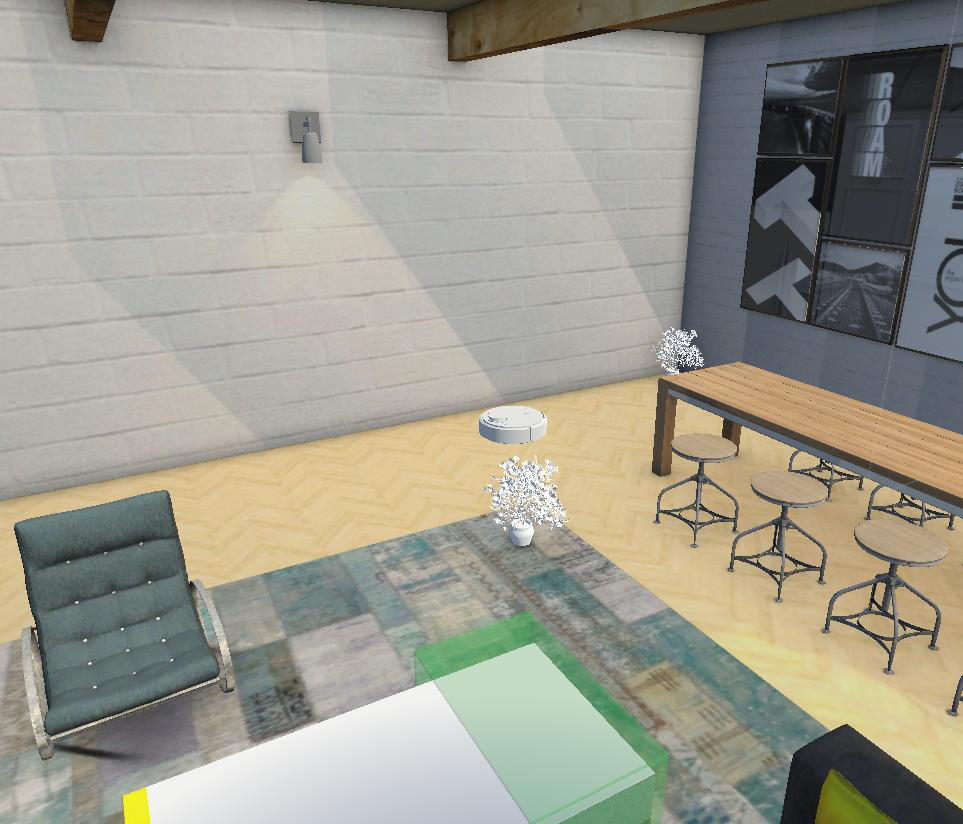

## Proje Tanımı

- Kirler belirli aralıklarla rastgele konumlarda oluşur.
- Oyuncu FPS bakış açısından robot süpürgeyi kontrol ederek kirleri temizler.
- Temizlenen her kir puan olarak yansıtılır.
- Oyun belirli sürelerde yeniden başlar.

## İçindekiler

1. [Prefab Kullanımı](#1-prefab-kullanımı)
2. [Vector3 ve Quaternion](#2-vector3-ve-quaternion)
3. [Partikül Efektleri](#3-partikül-efektleri)
4. [Instantiate](#4-instantiate)
5. [RayCast](#5-raycast)
6. [FixedUpdate veya LateUpdate](#6-fixedupdate-veya-lateupdate)
7. [DeltaTime Kullanımı](#7-deltatime-kullanımı)
8. [Arrays (Diziler)](#8-arrays-diziler)
9. [Trigger ve Collision](#9-trigger-ve-collision)
10. [Animation ve Animator](#10-animation-ve-animator)

---

## 1. Prefab Kullanımı

Oluşturulan kir objesi (`dirtPrefab`) bir prefab olarak tanımlanmıştır. `DirtManager` scripti aracılığıyla sahneye `Instantiate` edilerek oyun içinde tekrar tekrar kullanılmaktadır.

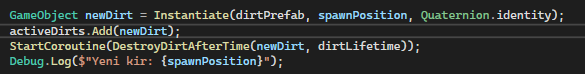

## 2. Vector3 ve Quaternion

Kirlerin sahnede rastgele pozisyonda oluşturulması ve robot süpürgenin hareketlerinde konum/rotasyon işlemleri `Vector3` ve `Quaternion` ile yapılmıştır.

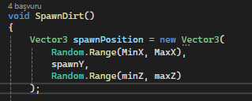

## 3. Partikül Efektleri

Kir temizlenme anında kullanılan görsel geri bildirimlerde partikül efektleri kullanılmıştır. Süpürge üzerine takılan particle system bu anlarda çalışmaktadır.

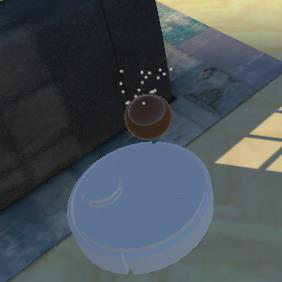

## 4. Instantiate

Prefab olan kirler, sahneye `Instantiate()` komutu ile eklenmiştir. Bu işlem `SpawnDirt()` fonksiyonu içinde yapılır.

## 5. RayCast

`FPSMovement` scriptinde `BoxCast` mantığıyla karakterin çarpışmalara karşı önlem alması sağlanmıştır. Bu, `Raycast`'in genişletilmiş halidir ve çarpmaları daha gerçekçi hale getirir.

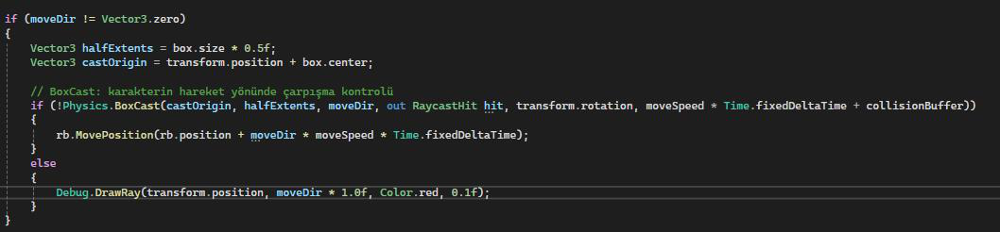

## 6. FixedUpdate veya LateUpdate

Süpürgenin fizik tabanlı hareketleri `FixedUpdate()` içinde tanımlanmıştır. Bu sayede hareketler fizik motoruyla uyumlu biçimde yürütülür.

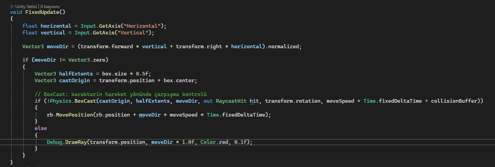

## 7. DeltaTime Kullanımı

Fare hareketi ve karakter dönüşlerinde kullanılan `Time.deltaTime`, hareketin bilgisayar performansından bağımsız düzgün olmasını sağlar.

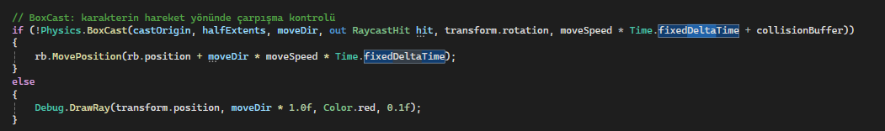

## 8. Arrays (Diziler)

Kir nesneleri `activeDirts` adlı bir `List<GameObject>` içinde tutulmuştur. Bu dizi oyun süresince aktif olan kirlerin kontrolü ve temizliği için kullanılmıştır.

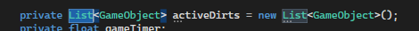

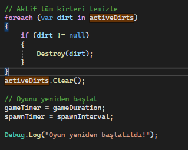

## 9. Trigger ve Collision

Kirlerin temizlenmesi `OnTriggerEnter()` fonksiyonu ile kontrol edilmiştir. Süpürge `Vacuum` etiketiyle tanımlanmış ve kir nesneleriyle çarpışınca yok edilmiştir.

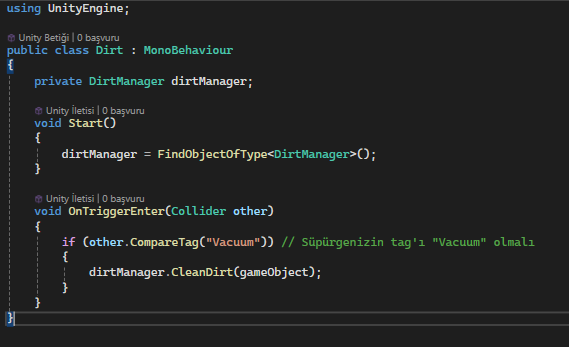

## 10. Animation ve Animator

Kirlerin hareketleri büyüme ve küçülme şeklindedir.

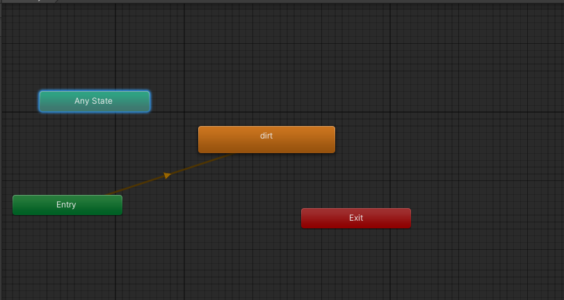
